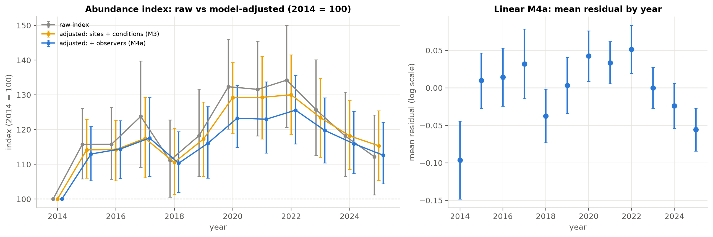

# Bird Biodiversity Trends in Martinique (2014–2025)

**Are Martinique's breeding birds declining, or does it only look that way because the way they are counted keeps changing?**

This project analyses 12 years of point-count monitoring data (≈112k records from 1,400+ transect visits across 65 transects of 10 points each) to separate real changes in bird populations from changes in survey effort and observers.



## Key findings

- **No decline in total abundance.** After adjusting for sites, survey conditions and observers, the community index in 2025 is about 13 % above 2014 (95 % CI 104–122, 2014 = 100), with a temporary peak in 2020–2022.
- **About a third of the naive trend is an observer effect.** The mix of observers changed over time; a simulation with no true trend reproduces a bias of the same size.
- **Diversity is stable, composition is not.** Species richness is flat once effort is accounted for, but the share of exotic individuals rose from ≈ 10 % to ≈ 15 %, driven by four recent colonisers. Declining species are concentrated among endemics.
- **Survey effort is not constant** (ramp-up in 2014, transects added until 2018), so every indicator is standardised per 5-minute point count, with absences treated as true zeros.

## Methods

- **Data cleaning** with a logged rule set: fuzzy matching of transect and observer names, effort reconstruction, zero-filling of absences.
- **Indicators**: abundance, richness (with rarefaction), exotic share, per-species indices, all as base-100 indices.
- **Uncertainty**: transect-level **cluster bootstrap** (B = 2000), since counts are overdispersed and spatially correlated (its SE is ≈ 3× the naive i.i.d. SE); delete-one-transect jackknife for rarefied richness.
- **Trend models**: a ladder of log-linear regressions (raw → + sites/conditions → + observer fixed effects), compared with residual diagnostics and cross-validated error, plus robustness checks.

## Repository structure

| Path | Content |
|---|---|
| `notebooks/01_data_and_effort.ipynb` | data structure, cleaning, survey effort over time and space, observers, detection |
| `notebooks/02_indicators_and_trends.ipynb` | indicators with 95 % CIs, choice of CI method, trend-model ladder, diagnostics |
| `notebooks/03_species.ipynb` | species-level indices, rates of change, trend classes |
| `notebooks/04_synthesis.ipynb` | headline results, limitations, recommendations |
| `src/` | reusable analysis modules (loading, cleaning, effort, indices, models, species, plotting) |
| `outputs/` | exported figures (`figNN_*.png`) and tables (`tableNN_*.csv`) |
| `run_all.py` | re-executes all notebooks in order |

## Reproduce

The raw monitoring data is not included in this repository (it was provided for coursework and contains observer information). With access to the workbook, place it at `data/raw/Observations 2012-2025.xlsx`, then:

```bash
python -m venv .venv && source .venv/bin/activate
pip install -r requirements.txt
python run_all.py
```

The notebooks are committed with their outputs, so all results and figures can be read without re-running anything. Random seeds are fixed in `src/config.py`.

**Stack:** Python, pandas, NumPy, SciPy, statsmodels, matplotlib, Jupyter

---

Course project for *Applied Statistics*, M1 Artificial Intelligence, Université Paris-Saclay (2026). All analysis and code by Yike Shi.
